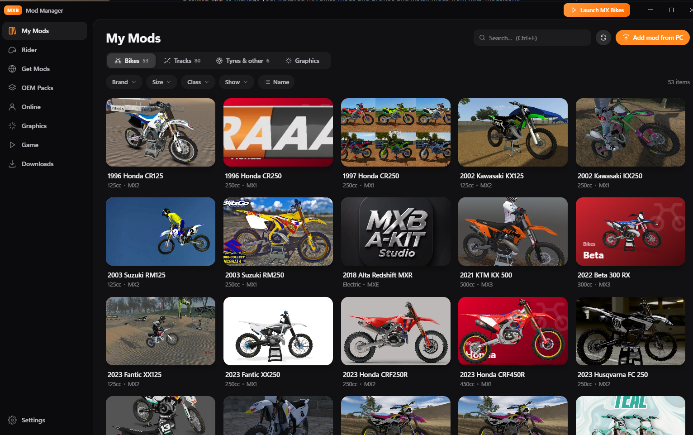
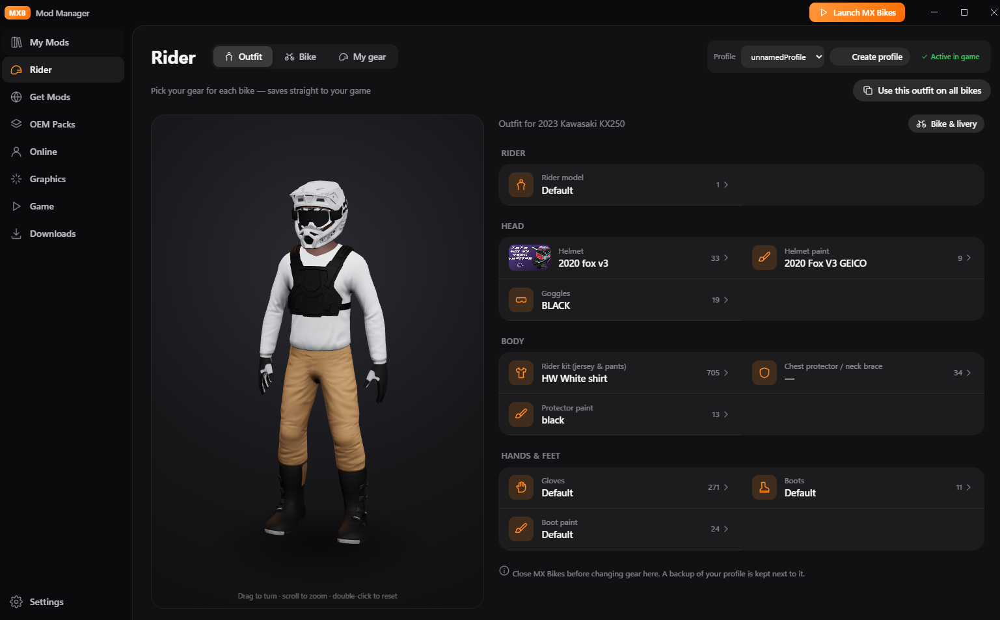
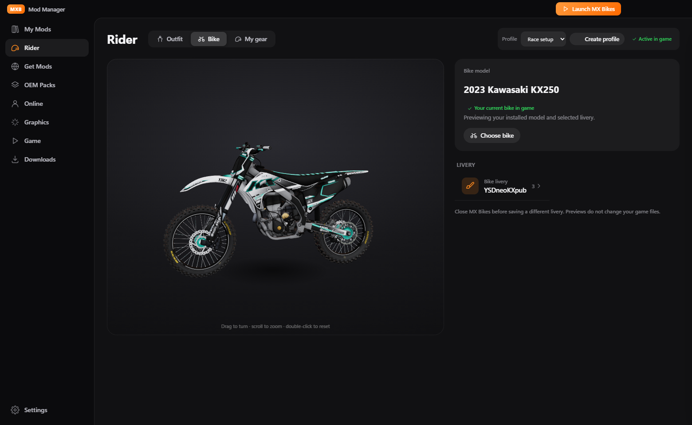
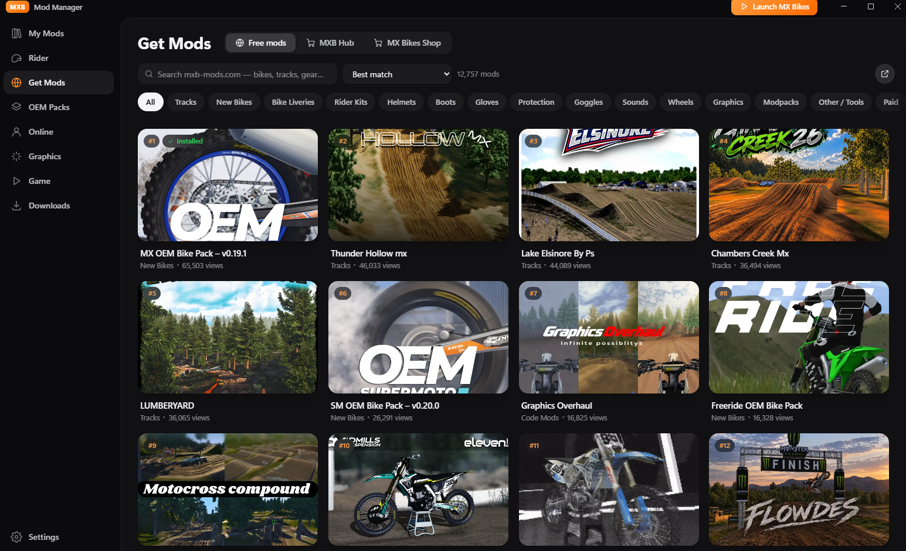
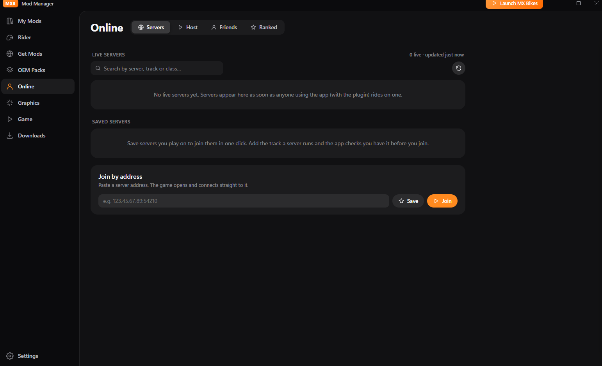

# MX Bikes Manager

**Your bikes, tracks, gear, and downloads in one place.**

MX Bikes Manager is a Windows desktop app for organizing your MX Bikes mods, finding new content, building rider outfits, and getting ready to ride. Browse your installed collection with pictures, preview your bike and gear in 3D, and install downloads into the right folders.

[**Download the Windows installer**](https://github.com/rare621/MXB-MANAGER/releases/latest) · [Report a problem](https://github.com/rare621/MXB-MANAGER/issues) · [Build from source](#build-from-source)



## Install and get started

1. Open [Releases](https://github.com/rare621/MXB-MANAGER/releases/latest) and download the latest **MX-Bikes-Manager-Setup-…-x64.exe**.
2. Run the setup and choose where to install it. The setup adds desktop and Start menu shortcuts.
3. Open **MX Bikes Manager**. It looks for your Steam game install and your `Documents\PiBoSo\MX Bikes` folder. You can choose the folders yourself if needed.
4. Browse **My Mods**, build an outfit under **Rider**, or find something new in **Get Mods**.

You need 64-bit Windows and your own copy of MX Bikes. The installed app includes its runtime, so you do **not** need Node.js, npm, or the source code. Game and mod assets shown in the screenshots are installed separately.

This first release is unsigned, so Windows may show an unknown-publisher warning. Each release includes `SHA256SUMS.txt` for checking the installer download. Uninstalling the manager keeps your game mods and manager settings.

## Keep your mods organized

**My Mods** brings bikes, tracks, tyres, and other installed content into a visual library.

- Search your collection and filter bikes by **brand, engine size, and class**.
- Favorite mods, see what's installed, and switch between grid and list views.
- Enable or disable content without permanently deleting it.
- Delete individual mods or paints through the Windows Recycle Bin.
- Set your own preview images, or search supported mod sites for a matching picture.

## Build your rider outfit

Choose your helmet, goggles, kit, gloves, boots, and protection with searchable, brand-filtered pickers. The 3D preview shows supported installed models and paints, with drag-to-rotate and scroll-to-zoom controls.



Save a different outfit for each bike, copy an outfit across your bikes, or create multiple **game profiles** for different gear setups. **My gear** also lets you manage rider models and individual bike paints, including brand and cc filtering for bike paints.

Close MX Bikes before changing game profiles or outfits. The manager keeps profile backups so the game does not overwrite your changes when it exits.

## Preview your bike and livery

The **Bike** tab shows the installed model with your selected paint applied. Turn it around, zoom in, and use the picture-grid picker to change bikes. Livery choices use their recorded download-page images.



Preview support depends on the installed asset format. Some creator-specific, account-bound, missing, or unsupported assets may not produce a preview.

## Find and install new content

**Get Mods** combines browsing for **mxb-mods.com**, **MXB Hub**, and **MX Bikes Shop**. Search for tracks, bikes, liveries, rider kits, helmets, gloves, and more.



- Open listings to see their description, pictures, and download choices.
- Sign in on a supported shop's own page to access **your purchases**.
- Install downloaded archives or drag files into the app.
- Review the destination when a download needs help finding the right model.
- Filter target bikes by **brand and cc** when installing paints.
- Use **OEM Packs** to compare supported packs with what you already have and install missing or changed files.

Paid content still requires a purchase and your own store account. Some download hosts need you to complete a step in the built-in browser. Compressed downloads require 7-Zip, WinRAR, or a supported Windows extraction tool.

## Get ready to ride

**Game** lets you choose a bike and track, launch MX Bikes, and edit supported game settings. **Fix & clean** checks for common folder problems, duplicate downloads, and archives left zipped in your mods folder, and shows a storage breakdown.

Install jobs clean up temporary staging files after completion, failure, or cancellation. Generated thumbnails are pruned over time, while images you've assigned to mods are preserved.

## Play online

Join or save a server address, use shareable join links, and configure a session under **Online → Host**. Host setup walks through choosing a track, naming the server, and picking a practice or race preset, with more settings available underneath.



Live presence, friends, and paint sharing use the included presence plugin and a **separately hosted online service**. The server list reflects participating app users; it is not the game's complete public server browser. Installers include the server address configured in `online.config.json`, so these shared features need that service running and reachable from the user's network. Local mod management, previews, profiles, and store browsing work independently.

Click a friend to see their equipped gear, selected paints, bike livery, server and track. **Sync equipped gear** shows progress and installs only missing files; identical files already in your mods folder or model packages are skipped. Your own outfit stays selected. **Get track & join** searches the creator's download pages and waits for the matching track to be installed before joining. A server address must be available through shared presence, a saved server, or a recent FrostMod server list.

Online hosts updating from 1.0.3 must also update **mxbm-server.js** from the release's **mxbm-online-service.zip**. Keep the existing account database and shared-file folder; see [server update instructions](server/README.md#update-an-existing-server).

To change the service address in an installed copy, close the manager and edit `%LOCALAPPDATA%\Programs\MX Bikes Manager\resources\online.config.json` in Notepad, then reopen the manager. If you chose another install folder, open its `resources\online.config.json` instead.

## Build from source

Use Node.js 24 or later:

```powershell
npm ci
npm start
```

Run the checks or build a Windows setup:

```powershell
npm test
npm run build:win
```

The setup EXE and checksum are written to `dist/`. [Release instructions](docs/RELEASING.md) explain the GitHub Actions workflow and optional online-service configuration. The online service is deployed separately; see [server setup](server/README.md).

## Feedback and credits

Found a problem? [Open an issue](https://github.com/rare621/MXB-MANAGER/issues) with the app version, what you clicked, and a screenshot if possible. Do not include account tokens or passwords.

An independent community project, not affiliated with PiBoSo or the supported mod stores. Game assets, mod content, and screenshots of installed content belong to their respective creators. Third-party format work and library notices are in [THIRD_PARTY_NOTICES.md](THIRD_PARTY_NOTICES.md).
